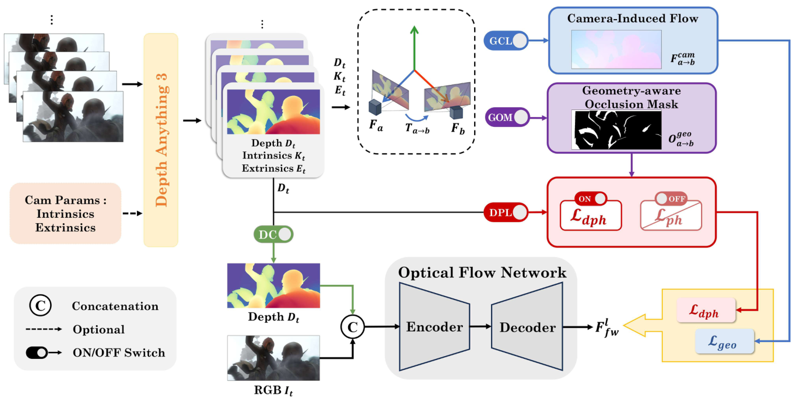
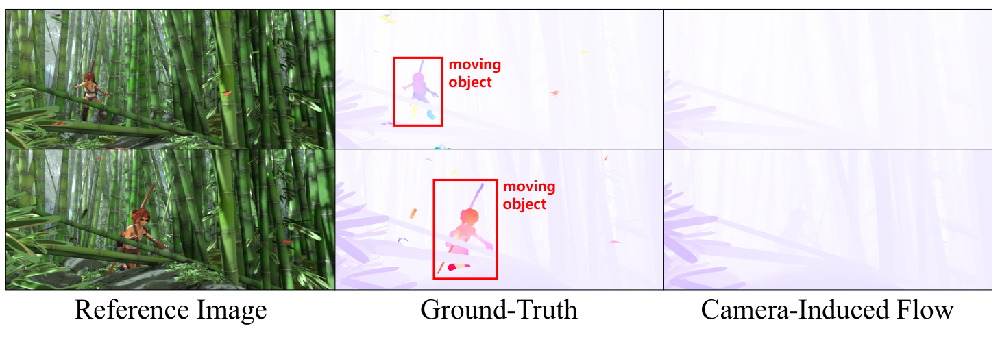
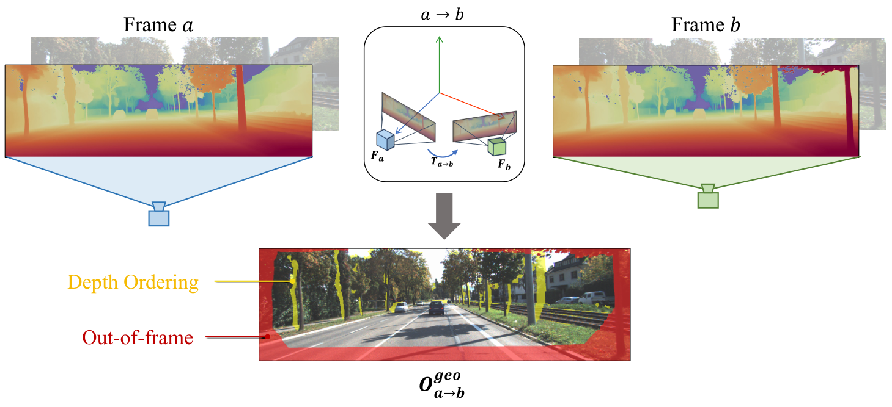
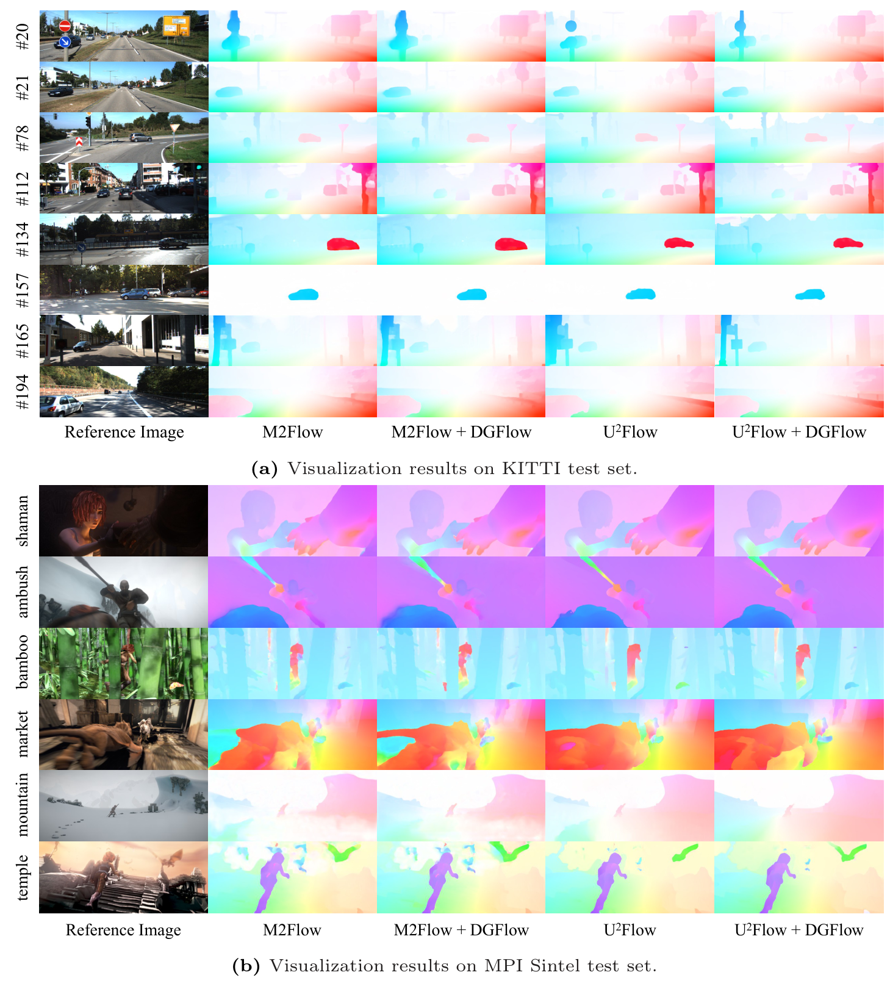

## Abstract (Kor)

본 연구는 연속된 두 영상 프레임 사이에서 각 픽셀이 어디로 움직였는지를 추정하는 **광학 흐름(optical flow) 추정** 기술을 다룬다. 광학 흐름은 자율주행, 객체 추적, 영상 이해 등 다양한 컴퓨터 비전 응용의 기반이 되지만, 실제 환경에서 픽셀 단위의 정답 움직임을 얻는 것은 매우 어렵고 비용이 크다. 이 때문에 정답 없이 영상만으로 학습하는 **비지도(unsupervised) 광학 흐름 추정**이 활발히 연구되고 있다.

비지도 기법은 한 프레임을 추정한 흐름으로 변형(warping)해 다른 프레임을 얼마나 잘 재구성하는지를 측정하는 **광도 손실(photometric loss)** 로 학습한다. 그러나 이 방식은 두 프레임 사이에 픽셀 대응이 확실히 존재한다는 가정에 의존하기 때문에, 물체에 **가려지는 영역(occlusion)**, **질감이 없는 표면(textureless region)**, **큰 카메라 움직임(ego-motion)** 이 있는 곳에서는 잘못된 학습 신호를 만들어 낸다. 장면의 **깊이(depth)** 와 **카메라 기하(camera geometry)** 는 어디서 가림이 발생하는지, 카메라 움직임만으로 어떤 흐름이 생기는지를 물리적으로 알려 주는 단서이지만, 기존 비지도 기법에서는 거의 활용되지 않았다.

이를 해결하기 위해 본 연구는 깊이 기반 모델인 Depth Anything 3 (DA3)로부터 얻은 **메트릭 깊이와 카메라 파라미터**를 활용하는 기하 기반 비지도 광학 흐름 프레임워크 **DGFlow**를 제안한다. DGFlow는 기존 네트워크 구조를 바꾸지 않고 독립적으로 켜고 끌 수 있는 **네 가지 plug-and-play 모듈**로 구성된다.

### 1) Depth Concatenation (DC)

정규화된 역깊이(normalized inverse depth)를 RGB 영상에 4번째 채널로 붙여 인코더에 입력한다. 이를 통해 네트워크가 가장 초기 단계부터 깊이를 인지한 특징을 계산하여, 깊이 경계와 질감이 없는 영역에서의 매칭 신뢰도를 높인다. 사전 학습된 3채널 모델의 첫 번째 합성곱 가중치를 0으로 초기화한 깊이 채널로 확장하여, 기존 RGB 특징을 보존하면서 안정적으로 학습을 이어갈 수 있다.

### 2) Geometry-aware Occlusion Mask (GOM)

기존 기법은 예측된 흐름 자체로 가림 영역을 추정하기 때문에, 흐름이 부정확한 학습 초기나 움직임 경계에서 오류가 누적된다. GOM은 깊이와 카메라 투영만으로 **화면 밖으로 벗어나는 픽셀(out-of-frame)** 과 **깊이 순서상 가려지는 픽셀(depth ordering)** 을 찾아내어, 예측 흐름과 **독립적인** 가림 마스크를 생성하고 신뢰할 수 없는 광도 손실을 억제한다.

### 3) Depth-aware Photometric Loss (DPL)

RGB뿐 아니라 정규화된 역깊이 채널도 함께 재구성하도록 광도 손실을 확장한다. 외관 정보가 부족해 기존 광도 손실의 기울기가 거의 사라지는 질감 없는 영역이나 움직임 경계에서, 깊이가 추가적인 구조적 단서를 제공한다.

### 4) Geometric Consistency Loss (GCL)

정적인 영역에서는 장면의 움직임이 카메라 움직임과 깊이만으로 대부분 설명된다. GCL은 깊이와 상대 카메라 자세로 계산한 **카메라 유도 흐름(camera-induced flow)** 과 예측 흐름 사이의 차이를 줄이도록 학습한다. 단, 움직이는 물체에서는 카메라 유도 흐름이 틀리므로, 깊이·투영·가림·의미 분할 정보 등으로 구성한 신뢰도 마스크를 통해 **신뢰할 수 있는 정적 영역에만** 선택적으로 적용한다.

제안한 모듈들은 대표적인 최신 비지도 광학 흐름 기법인 M2Flow와 U2Flow에 통합하여 검증하였다. 그 결과 KITTI와 MPI Sintel 벤치마크 모두에서 일관된 성능 향상을 보였으며, 특히 U2Flow 기준 **KITTI 2015 테스트 F1-all을 6.13%에서 5.84%로**, **MPI Sintel Final 테스트 EPE를 4.16에서 3.71로** 개선하였다. GOM, DPL, GCL은 학습 시에만 사용되어 추론 비용을 늘리지 않으며, 전체 구성에서도 추가 파라미터는 약 0.12%에 불과하다.

## Abstract (Eng)

This study addresses **optical flow estimation**—estimating where each pixel moves between two consecutive video frames. Optical flow underpins many computer vision applications such as autonomous driving, object tracking, and video understanding, but obtaining dense ground-truth motion in real-world scenes is prohibitively expensive. This has motivated **unsupervised optical flow estimation**, which learns motion directly from unlabeled videos.

Unsupervised methods are trained with a **photometric loss** that measures how well one frame can be reconstructed by warping the other with the predicted flow. This relies on the assumption that reliable pixel correspondences exist between frames—an assumption that breaks down under **occlusions**, on **textureless surfaces**, and under **large camera ego-motion**, producing incorrect supervision signals. Scene **depth** and **camera geometry** physically encode where occlusions occur and what motion the camera alone induces, yet these cues have remained largely underutilized in unsupervised optical flow learning.

To address this, we propose **DGFlow**, a geometry-guided unsupervised optical flow framework that leverages **metric depth and camera parameters** estimated by the Depth Anything 3 (DA3) foundation model. DGFlow consists of **four plug-and-play modules** that can be independently enabled or disabled without modifying the base architecture.

### 1) Depth Concatenation (DC)

Normalized inverse depth is concatenated with the RGB image as a fourth input channel to the encoder, allowing the network to compute depth-aware features from the earliest stage and improving matching reliability across depth boundaries and in textureless regions. The first convolutional layer of a pretrained 3-channel model is expanded with a zero-initialized depth channel, preserving pretrained RGB features while allowing training to continue seamlessly.

### 2) Geometry-aware Occlusion Mask (GOM)

Conventional methods estimate occlusion from the predicted flow itself, so errors compound during early training and around motion boundaries. GOM identifies **out-of-frame** pixels and pixels occluded by **depth ordering** purely from depth and camera projection, producing occlusion masks that are **independent of the predicted flow** and suppressing unreliable photometric supervision.

### 3) Depth-aware Photometric Loss (DPL)

The photometric loss is extended to reconstruct the normalized inverse depth channel alongside RGB. Where appearance is uninformative and the RGB photometric loss provides near-zero gradient—such as textureless regions and motion boundaries—depth supplies complementary structural cues.

### 4) Geometric Consistency Loss (GCL)

In static regions, apparent motion can largely be explained by depth and camera motion alone. GCL penalizes the discrepancy between the predicted flow and the **camera-induced flow** computed from depth and the relative camera pose. Since camera-induced flow is incorrect on independently moving objects, GCL is applied **only in reliable static regions**, selected by a reliability mask built from depth validity, projection validity, occlusion, and semantic cues.

We validate the proposed modules by integrating them into two state-of-the-art unsupervised optical flow methods, M2Flow and U2Flow. DGFlow yields consistent improvements on both KITTI and MPI Sintel; notably, it reduces U2Flow's **KITTI 2015 test F1-all from 6.13% to 5.84%** and **MPI Sintel Final test EPE from 4.16 to 3.71**. GOM, DPL, and GCL are used only during training and add no inference cost, and the full configuration adds only about 0.12% additional parameters.
